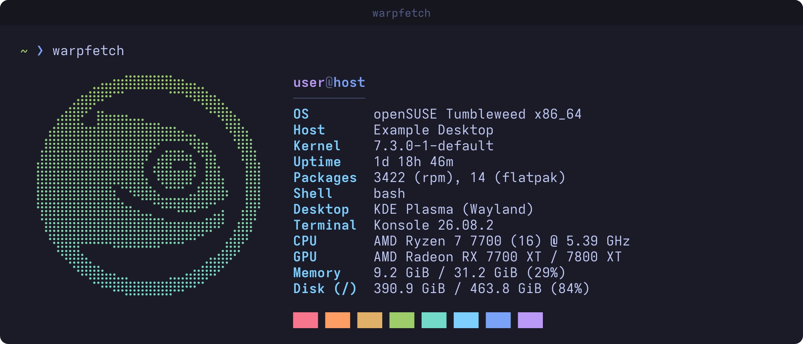
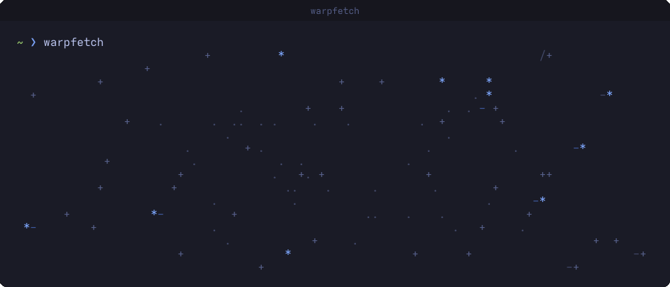
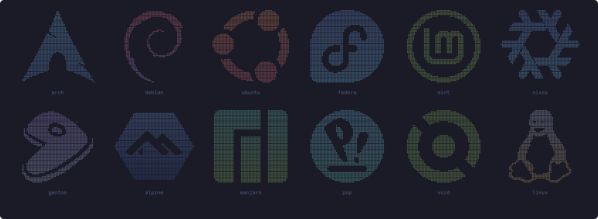

<div align="center">

# warpfetch

A fast system info fetch for the terminal, with a starfield intro.

[](https://github.com/benorrin/warpfetch/actions/workflows/ci.yml)
[](LICENSE)



</div>

I wrote this because neofetch took nearly four seconds to open on my
openSUSE machine. Almost all of that was `rpm -qa` counting packages, and it
happened in every new terminal.

warpfetch reads what it needs straight from `/proc`, `/sys` and `/etc`, so
gathering the info takes a few milliseconds. Package databases that can only
be queried slowly (rpm, xbps, nix) are counted in the background and cached
until they change. The only thing you wait for is the intro, which is about a
second long and can be turned off.

## The intro

Stars streak out from the centre, the field clears, and your distro's logo
fades in dot by dot while the info lines appear beside it.

<div align="center">

</div>

## Logos

The logo is picked from `/etc/os-release`. If your distro's `ID` isn't known,
warpfetch tries each entry in `ID_LIKE`, so derivatives get their parent's
logo (CachyOS shows Arch, for example). Anything else gets Tux.

<div align="center">

</div>

Available logos: `opensuse`, `arch`, `debian`, `ubuntu`, `fedora`, `mint`,
`manjaro`, `pop`, `endeavouros`, `gentoo`, `nixos`, `alpine`, `void`, `rhel`,
`centos`, `rocky`, `alma`, `kali`, `elementary`, `zorin`, `mx`, `artix`, and
`linux` (Tux).

Package counts cover rpm, dpkg, pacman, apk, portage, xbps and nix, plus
Flatpak and Snap.

## Install

Needs Rust 1.88 or newer.

```sh
cargo install --git https://github.com/benorrin/warpfetch
```

To run it whenever a terminal opens, add this to `~/.bashrc`:

```sh
[[ $- == *i* && -t 1 ]] && command -v warpfetch >/dev/null && { echo; warpfetch; printf '\e[?25h'; }
```

The checks keep it out of scripts and non-interactive shells, and the
`printf` brings the cursor back if you press Ctrl-C during the animation.

## Usage

```
warpfetch [--no-anim] [--logo NAME]

  --no-anim     Print the info straight away, without the animation
  --logo NAME   Show NAME's logo instead of detecting the distro
  --list-logos  List the available logo names
  -h, --help    Show help
  -V, --version Show the version
```

`WARPFETCH_NO_ANIM` skips the animation and `WARPFETCH_LOGO` sets a default
logo. The animation is also skipped when output isn't a terminal, and narrow
terminals get the info without the logo.

Slow package counts are cached in `~/.cache/warpfetch` (or
`$XDG_CACHE_HOME/warpfetch`). The very first run shows `counting…` while the
background count finishes.

## Terminal requirements

- 24-bit colour. Konsole, GNOME Terminal, kitty, Alacritty and WezTerm all
  support it.
- A font with braille characters for the logo. If the logo looks patchy or
  misaligned, try Hack, DejaVu Sans Mono or JetBrains Mono.
- 64-bit Linux.

The colours are Tokyo Night. There's a matching Konsole colour scheme in
`extras/TokyoNight.colorscheme`: copy it to `~/.local/share/konsole/` and pick
it under Settings → Edit Current Profile → Appearance.

## Adding a logo

Logos live in `src/logos.rs`. `tools/logo2braille.py` converts a
single-colour SVG or PNG to braille art. It needs ImageMagick, plus KDE's
`ksvgtopng` for SVGs.

```sh
tools/logo2braille.py icon.svg            # fits 28 x 13 cells by default
tools/logo2braille.py --bold 12 icon.svg  # thicken thin strokes first
```

Add a `Logo` entry with its `/etc/os-release` IDs and two palette colours for
the gradient, then run `cargo test` to check it fits the layout.

## Development

```sh
cargo fmt --check
cargo clippy --all-targets -- -D warnings
cargo test
```

## Licence

GPL-3.0-or-later. See [LICENSE](LICENSE).

The distro logos are converted from [Simple Icons](https://simpleicons.org)
(CC0), except the openSUSE Geeko, which comes from the openSUSE branding
artwork. Each logo is a trademark of its owner and is only used to show which
distro you're running. warpfetch isn't affiliated with any of these projects.
